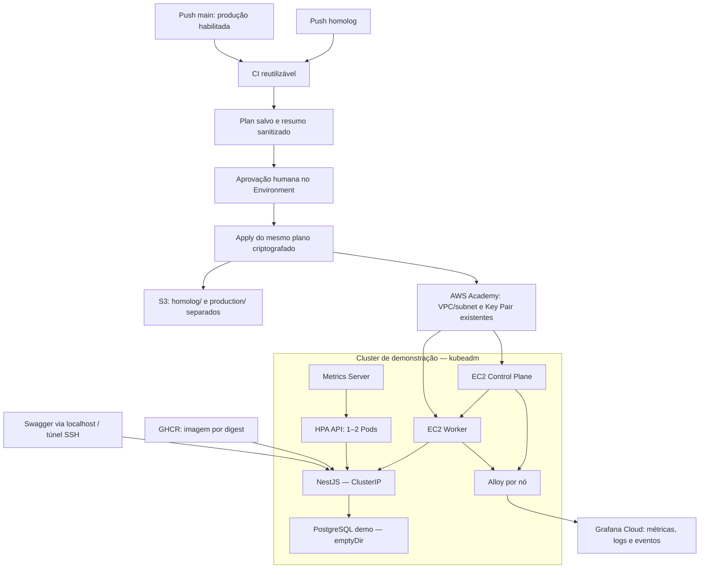

# Tech Challenge FIAP — Fase 3 | Infraestrutura Kubernetes

## 1. Objetivo

Provisionar e operar Kubernetes com Terraform no AWS Academy Learner Lab.
O cluster usa **kubeadm em duas EC2 Ubuntu, sem EKS**, com containerd, Calico,
Metrics Server e Grafana Cloud/Alloy.

A demonstração executou o NestJS do fork da aplicação com PostgreSQL temporário,
sem utilizar o banco compartilhado da equipe. A organização deste README segue
a referência local da Fase 2: `techChallengePosTech_v2/README.md`.

## 2. Arquitetura



O diagrama combina o pipeline e o cluster de demonstração. O workflow Terraform
não implanta NestJS nem executa join do Worker. Produção tem configuração própria;
não foi provisionada nesta implementação local. Um Control Plane e um Worker
constituem uma topologia de laboratório, com pontos únicos de falha.

## 3. Tecnologias

| Camada | Implementação |
| --- | --- |
| Infraestrutura | Terraform 1.16.5; AWS provider 6.68.0 no lockfile |
| AWS | EC2 t3.medium, gp3 de 20 GB, Security Group, state S3 com lock |
| Kubernetes | kubeadm 1.34, Ubuntu 24.04, containerd, Calico 3.30.3 |
| Escalabilidade | Metrics Server 0.8.0, HPA autoscaling/v2 |
| Observabilidade | Grafana Cloud, Alloy, Helm 3.22.1, chart 4.5.5 |
| CI | Node 22, actionlint, kubeconform, Helm lint/template |
| Demonstração | NestJS/Prisma e PostgreSQL efêmero |

## 4. Organização e navegação

| Documento/diretório | Finalidade |
| --- | --- |
| [COMECE-AQUI](COMECE-AQUI.md) | Início rápido |
| [GUIA-EXECUCAO](GUIA-EXECUCAO.md) | Operação e reprodução em outra conta |
| [docs/](docs/INDEX.md) | Arquitetura, decisões e CI/CD |
| [evidencias/](evidencias/INDEX.md) | Comprovações e origem dos resultados |
| [observability/](observability/PLANO-GRAFANA.md) | Grafana Cloud Lightweight |
| environments/homolog/ e environments/production/ | Terraform independente por ambiente |
| modules/ec2/ e modules/security/ | EC2, cloud-init e comunicação entre nós |
| scripts/ e tests/ | Operação e testes de segurança |

## 5. CI/CD

| Branch | Environment Plan | Aprovação Apply | State |
| --- | --- | --- | --- |
| homolog | homolog | homolog-apply | homolog/terraform.tfstate |
| main | production | production-apply | production/terraform.tfstate |

Push/merge inicia CI, Terraform Validate e Plan salvo. Após revisão, o Apply
aguarda **aprovação humana obrigatória**. Produção exige também a variável de
repositório `PRODUCTION_CAPACITY_APPROVED=true`, após revisão de capacidade/custos.
Não se presume que o Lab suporta dois clusters simultâneos.

O Apply usa somente o plano salvo da mesma execução: AES-256-GCM, integridade,
prazo de quatro horas e vínculo com conta, região, commit, run/tentativa,
repositório, ambiente, bucket e chave do state. Credenciais temporárias Academy
são verificadas antes do Plan e novamente depois da aprovação.

Exclusões, substituições, atualizações de user-data e alterações disruptivas de
EC2 são bloqueadas. As duas EC2 ignoram mudanças de user-data. Outras mudanças
permitidas continuam sujeitas à revisão humana. O fluxo começa automaticamente;
**não é Apply automático sem aprovação**.

Produção foi implementada e validada localmente. Os resultados de homologação
estão no [índice de evidências](evidencias/INDEX.md).
Por padrão, o guard autoriza o fork felipevrds; o original FernandoGreco requer
[configuração explícita](GUIA-EXECUCAO.md#reprodução-em-outra-conta-aws-e-configuração-do-github-actions).

## 6. Execução e validação

Pré-requisitos: Git Bash/SSH, AWS CLI e Terraform. Credenciais e chave SSH ficam
fora do Git. Da raiz, com ferramentas instaladas:

```bash
node --test tests/cicd-guards.test.mjs
terraform fmt -check -recursive environments modules
find scripts modules/ec2/user-data tests observability -name '*.sh' -type f -print0 | xargs -0 -r -n 1 bash -n
```

Init sem backend, validate e demais ferramentas estão no [guia](GUIA-EXECUCAO.md).
Provisionamento, bootstrap, carga e limpeza são operações distintas, autorizadas
separadamente. Não repetir provisionamento para demonstrar um cluster operacional.

## 7. Demonstração da aplicação e HPA

O [fork NestJS](https://github.com/felipevrds/techChallengePosTech-Aplication/tree/feature/deploy-kubernetes)
utiliza imagem por digest, Service ClusterIP e startup `node dist/main.js`.
Um Job separado preparou o schema, sem seed. PostgreSQL usa `emptyDir`: é
descartável, pode perder dados com substituição do Pod e **não é RDS**.

Swagger validado em `http://127.0.0.1:18080/api/docs`, somente com túnel ativo.
Não é endpoint público permanente. Consulte os
[comandos de acesso](GUIA-EXECUCAO.md#acesso-local-ao-swagger).

- HPA sintético em hpa-lab: alvo 50% CPU, 1–4 réplicas, escala observada 1→4→1.
- HPA da API: alvo 70% CPU, 1–2 réplicas. O responsável informou escala 1→2,
  9.986 respostas HTTP bem-sucedidas e zero erros. O gerador rodou dentro do Pod:
  **não é benchmark independente**. A confirmação tem
  [origem identificada](evidencias/2026-10-28-resultados-informados.md).

## 8. Grafana Cloud e evidências

Alloy coleta métricas de cluster/nós/pods, logs e eventos Kubernetes.
A configuração Lightweight usa seis Pods permanentes, sem servidores locais
Grafana/Prometheus/Loki. Os values referenciam Secret existente, sem credenciais.

| Resultado | Evidência |
| --- | --- |
| Nós, Calico, Metrics Server e HPA sintético | [Kubernetes/HPA](evidencias/2026-10-27-kubernetes-hpa.txt) |
| Idempotência Metrics Server | [Comparação](evidencias/2026-10-27-metrics-idempotencia.txt) |
| Métricas recentes Cloud | [API](evidencias/2026-10-27-grafana-cloud-api.json) |
| Logs/eventos Loki, confirmação manual | [Registro](evidencias/2026-10-27-grafana-validacao-manual.md) |
| NestJS, Job e PostgreSQL | [Resultado](evidencias/tc3-deploy-resultado-local.json) |
| Logs NestJS Loki, confirmação manual | [Registro](evidencias/tc3-deploy-loki-confirmacao-manual-local.json) |
| CI real e correção do lockfile | [Registro](evidencias/2026-10-27-ci-github-feature.md) |
| HPA final e Apply sem alterações, informados pelo responsável | [Origem e alcance](evidencias/2026-10-28-resultados-informados.md) |
| Fluxo homolog/main testado localmente | [Testes](docs/VALIDACAO-LOCAL-CICD.md) |

Traces não estão incluídos nas validações comprovadas.
Veja a [configuração Grafana](observability/PLANO-GRAFANA.md) e o
[índice completo](evidencias/INDEX.md).

## 9. Segurança operacional

Não versionar credenciais, PATs, .env, chaves, kubeconfig administrativo, tfvars,
state ou planos. Validar host keys SSH por canal confiável. Scripts de
provisionamento/carga/limpeza não são diagnóstico de leitura. Limpeza tem escopo
e autorização próprios e não faz parte dos workflows.
