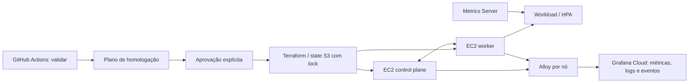

# Tech Challenge FIAP Fase 3 — infraestrutura Kubernetes

Terraform e Kubernetes kubeadm em duas EC2 Ubuntu 24.04 no AWS Academy Learner
Lab, região us-east-1. Usa VPC, subnet e Key Pair existentes; não utiliza EKS.
A aplicação NestJS e o banco são mantidos em outros repositórios.

## Arquitetura



Componentes: Kubernetes 1.34, containerd, Calico 3.30.3, Metrics Server 0.8.0,
Helm 3.22.1 e Grafana Kubernetes Monitoring chart 4.5.5. As EC2 t3.medium têm
discos gp3 de 20 GB. Um control plane é ponto único de falha; não há alta
disponibilidade de control plane ou autoscaling de EC2 implementados.

## Estrutura

- environments/homolog/: configuração Terraform e backend S3.
- modules/security/: comunicação entre nós e SSH restrito por CIDR.
- modules/ec2/: EC2 e cloud-init; modules/network/ não é utilizado em homolog.
- scripts/: operação local, validação e barreiras de segurança do CI/CD.
- tests/: testes das barreiras e laboratório HPA sem aplicação/banco do grupo.
- observability/: valores, RBAC, instalação e validação sem credenciais versionadas.
- .github/workflows/: CI reutilizável e fluxo protegido de homologação.

## Provisionamento local — somente com autorização

Pré-requisitos: AWS CLI v2, Terraform 1.16.5, Bash e SSH. Iniciar o Learner Lab,
configurar as três credenciais temporárias no perfil local academy-tc3, fora do
repositório, e confirmar a conta. Reutilizar o bucket e o estado existentes;
não criar infraestrutura duplicada.

```bash
export AWS_PROFILE=academy-tc3
export AWS_REGION=us-east-1
export EXPECTED_AWS_ACCOUNT_ID="<ACCOUNT_ID>"
export SSH_PRIVATE_KEY_PATH="/c/caminho/fora/do/repositorio/labsuser.pem"
export SSH_USER=ubuntu

aws sts get-caller-identity --profile academy-tc3 --region us-east-1
mkdir -p environments/homolog/accounts
cp environments/homolog/terraform.tfvars.example "environments/homolog/accounts/${EXPECTED_AWS_ACCOUNT_ID}.tfvars"
```

Editar o arquivo privado local com VPC, subnet, nome do Key Pair e CIDR SSH.
Nunca versionar tfvars reais, credenciais, chave, kubeconfig, state ou planos.
O bucket padrão é fiap-tc3-k8s-tfstate-<ACCOUNT_ID>; TF_BACKEND_BUCKET pode substituir
o nome. Backend S3 usa criptografia e lockfile; credenciais não são gravadas nele.

Para uma necessidade real de provisionamento, após revisão e autorização:

```bash
bash scripts/deploy.sh
```

O script gera o plano, exige sim antes de aplicar e depois executa bootstrap,
join do worker, espera Calico e instala Metrics Server. Pode modificar recursos;
não é diagnóstico de leitura. Em GitHub Actions ele é bloqueado, para impedir
que contorne a aprovação do fluxo separado. Não abre SSH temporário no SG.

O control plane prepara o instalador de métricas no cloud-init; sua execução
fica após a associação do worker. Join usa token de dez minutos. Reexecução do
instalador de métricas mantém os mesmos argumentos, sem duplicações.

## Verificação Kubernetes somente de leitura

Com SSH já autorizado e a chave do host validada por canal confiável, executar
da raiz do repositório:

```bash
ssh -i "$SSH_PRIVATE_KEY_PATH" \
  -o BatchMode=yes -o StrictHostKeyChecking=yes -o ConnectTimeout=5 \
  "ubuntu@<CONTROL_PLANE_PUBLIC_IP>" 'bash -se' < scripts/check-k8s-readonly.sh
```

Confere dois nós Ready, Calico, CoreDNS, Metrics Server e kubectl top nodes.
O contexto esperado é kubernetes-admin@kubernetes. Não usar ssh-keyscan como
prova de identidade. scripts/validate-k8s.sh é legado e inicializa o backend;
não utilizá-lo como verificação estritamente de leitura.

## HPA isolado

No control plane, com os arquivos tests/ disponíveis e permissão para criar
recursos no namespace hpa-lab:

```bash
bash tests/hpa-iniciar.sh
kubectl -n hpa-lab get hpa,pods -w
```

Alvo CPU 50%, entre uma e quatro réplicas. A escala leva alguns minutos;
a redução respeita a janela de estabilização. Para remover o laboratório,
somente após confirmar que o namespace é exclusivo do teste e autorizar limpeza:

```bash
bash tests/hpa-limpar.sh
```

A prova sintética não valida a aplicação NestJS ou o banco compartilhado.

## Grafana Cloud Lightweight

Configuração efetiva: observability/grafana-lightweight.values.yaml.
Release grafana-cloud, namespace grafana-monitoring, cluster
kubernetes-admin-kubernetes. Métricas de cluster/nós/pods, logs de containers e
eventos são explícitos no values. Fleet/Beyla, profiling e OpenCost desabilitados.
São seis pods permanentes, requests totais 330m CPU/480Mi RAM.

Não reinstalar um release existente pelo assistente. Para reprodução autorizada:

1. Criar namespace grafana-monitoring no cluster correto.
2. Salvar o comando gerado pelo Grafana em arquivo privado fora do repositório.
   criar-credenciais.ps1 lê apenas campos conhecidos e consulta os destinos,
   sem executar o comando recebido.
3. No Windows, executar o helper com o caminho da chave. O arquivo privado
   padrão é %TEMP%/grafana-tc3-install.private.txt; pode ser informado por
   -PrivateCommandPath. O helper falha se o Secret já existir, sem rotação implícita.

```powershell
./observability/criar-credenciais.ps1 -SshKeyPath "C:\caminho\privado\labsuser.pem"
```

4. Copiar instalar-monitoramento.sh, grafana-rbac.yaml e
   grafana-lightweight.values.yaml para uma mesma pasta no control plane.
5. Naquela pasta, executar bash instalar-monitoramento.sh. Instala Helm após
   verificação SHA256, aplica o RBAC e aguarda o release e os agentes por nó.

O Secret grafana-cloud-credentials é transmitido por stdin/SSH, nunca passado ao
Helm. Os valores referenciam suas chaves; não contêm senhas. Secret é Base64/RBAC,
não garantia de criptografia no etcd. O operador fica restrito ao namespace; o
coletor tem descoberta/métricas/eventos de leitura e acesso ao seu Secret.

No control plane: bash verificar-coleta.sh, com o script disponível. No Windows:

```powershell
./observability/validar-cloud.ps1
```

A validação Cloud usa o arquivo privado apenas em memória e imprime contagens/
timestamps. Se faltar logs:read, confirmar Loki no portal; não confundir falha
de leitura com falha de escrita. Consultas, últimos 15–30 minutos:

```logql
{cluster="kubernetes-admin-kubernetes",namespace="grafana-monitoring"}
{cluster="kubernetes-admin-kubernetes",job="integrations/kubernetes/eventhandler"}
```

O smoke-test.yaml cria um pod temporário identificado por tc3-observability-check;
executar somente com autorização. Não há Grafana/Prometheus/Loki Server local.
TLS de laboratório do kubelet precisa ser revisto para produção.

## CI/CD

Terraform Validate: push feature/** ou main, PR para homolog/main, dispatch e
workflow_call. Valida Terraform sem backend, 16 Bash, parsing PowerShell, testes
Node, workflows, manifests e Helm. Não usa secrets, state ou acesso ao cluster.

Terraform Deploy reutiliza o mesmo CI e depende do seu sucesso:

| Evento/operação | Efeito |
| --- | --- |
| Push homolog | CI e plan; nunca apply automático |
| Dispatch action=validate (padrão) | CI sem AWS |
| Dispatch action=plan em homolog | CI e plan |
| Dispatch action=apply em homolog | CI, plano, confirmação e aprovação protegida |

Apply exige confirm_apply=APLICAR HOMOLOG e Environment homolog-apply com reviewers,
somente branch homolog e sem bypass de administrador. Um guard verifica as regras
e falha se faltarem. Usa somente o plano salvo do mesmo run/commit/conta/região,
criptografado com AES-256-GCM, válido por quatro horas. Exclusões/substituições
são bloqueadas. Resumo mostra ações e nomes dos campos, sem valores privados.

Configurar no GitHub, sem enviar valores ao chat:

- Proteger main/homolog e exigir PR e check de CI.
- Environment homolog: AWS_ACCESS_KEY_ID, AWS_SECRET_ACCESS_KEY, AWS_SESSION_TOKEN,
  TFVARS_HOMOLOG; variables AWS_ACCOUNT_ID e TF_BACKEND_BUCKET.
- Environment homolog-apply: os três secrets AWS e as mesmas variables, reviewers,
  política única homolog e bypass administrativo desabilitado.
- TF_PLAN_ENCRYPTION_KEY: mesmo valor aleatório de ao menos 32 caracteres nos
  dois Environments, ou secret de repositório. Não publicar o valor.
- Renovar o conjunto de credenciais Academy antes de operações AWS, inclusive
  após espera por aprovação. O perfil local não autentica runners.
- AUTO_APPROVE_DEPLOY e TERRAFORM_STATE_ROOT não são usados neste fluxo.

Verificação Kubernetes opcional: dispatch action=validate e verify_kubernetes=true.
Requer SSH_PRIVATE_KEY, CONTROL_PLANE_HOST e SSH_KNOWN_HOSTS em homolog e acesso
de rede já autorizado. Não abre SG. Não habilitar antes de definir conectividade;
IP de runner hospedado não é automaticamente autorizado.

Para testes locais sem AWS:

```bash
node --test tests/cicd-guards.test.mjs
find scripts modules/ec2/user-data tests observability -name '*.sh' -type f -print0 | xargs -0 -r -n 1 bash -n
```

CI fixa Terraform 1.16.5, Node 22, actionlint 1.7.12, kubeconform 0.8.0 e Helm
3.22.1. Kubeconform verifica recursos nativos em modo strict; apenas Alloy e sua
CRD são excluídos por falta de schema no catálogo. Não é teste de admissão real.
Bash -n não equivale a ShellCheck, que não está habilitado.

## Limites e integração da equipe

Produção não está implementada. Push homolog só planeja, conforme política de
aprovação solicitada; a entrega de produção e promoção precisa ser definida.
O deploy NestJS pertence ao outro repositório: combinar imagem por SHA/digest,
namespace/RBAC, Secrets, requests/limits, probes, Service e Gateway. Revisar
migrations/seeds antes de múltiplas réplicas contra banco compartilhado. Swagger
e fluxos de autenticação são responsabilidades da aplicação e integração do grupo.

scripts/destroy.sh é destrutivo e exige DESTRUIR; não faz parte do CI/CD. Nunca
executar destroy, kubeadm reset ou recriação de EC2 sem autorização explícita.
