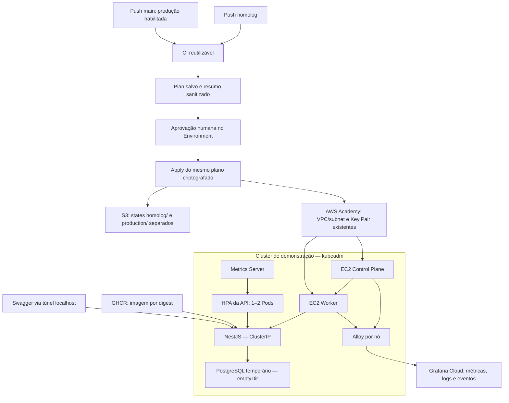

# Tech Challenge FIAP — Fase 3 | Infraestrutura Kubernetes

## 1. Objetivo

Provisionar e operar Kubernetes com Terraform no AWS Academy Learner Lab.
O cluster utiliza **kubeadm em duas EC2 Ubuntu, sem EKS**, com containerd, Calico,
Metrics Server e Grafana Cloud/Alloy.

A aplicação NestJS foi demonstrada com PostgreSQL temporário em namespace
exclusivo, sem utilizar o banco compartilhado da equipe.

## 2. Arquitetura



O diagrama representa o fluxo Terraform e os componentes demonstrados.
O workflow Terraform não implanta NestJS nem executa join do Worker.
Control Plane e Worker únicos são pontos de falha; HPA aumenta Pods, não EC2.
Produção teve Plan e Apply confirmados, com duas EC2 próprias, volumes
criptografados, Security Group e state independente. A validação AWS não equivale
à validação Kubernetes: uma etapa pós-Apply associou o Worker e validou dois nós
Ready, Calico, Metrics Server com TLS e HPA sintético 1→2→1 em produção.

## 3. Tecnologias

| Camada | Implementação |
| --- | --- |
| Infraestrutura | Terraform 1.16.5; AWS provider 6.68.0 no lockfile |
| AWS | EC2 t3.medium, gp3 de 20 GB, Security Group, state S3 com lock |
| Kubernetes | kubeadm 1.34, Ubuntu 24.04, containerd, Calico 3.30.3 |
| Escalabilidade | Metrics Server 0.8.0, HPA autoscaling/v2 |
| Observabilidade | Grafana Cloud, Alloy, Helm 3.22.1, chart 4.5.5 |
| CI | Node 22, Python 3, actionlint, kubeconform, Helm lint/template |
| Aplicação demonstrada | NestJS/Prisma e PostgreSQL efêmero |

## 4. Documentação

| Documento | Conteúdo |
| --- | --- |
| [COMECE-AQUI](COMECE-AQUI.md) | Início rápido |
| [GUIA-EXECUCAO](GUIA-EXECUCAO.md) | Operação e reprodução em outra conta |
| [Arquitetura](docs/ARQUITETURA-INFRA.md) | Componentes e responsabilidades |
| [CI/CD](docs/CI-CD.md) | Execuções reais, requisitos e aprovações |
| [ADRs e requisitos](docs/INDEX.md) | Decisões e rastreabilidade |
| [Grafana Cloud](observability/PLANO-GRAFANA.md) | Configuração Lightweight |
| [Evidências](evidencias/INDEX.md) | Resultados, fontes e alcance |

Fechamento verificado em **29/10/2026**:

- [Homologação](docs/EVIDENCIAS-HOMOLOG.md): Plan/Apply históricos, preservação AWS,
  dois nós Ready e workloads reconsultados por SSH.
- [Produção](docs/EVIDENCIAS-PRODUCAO.md): Apply com seis criações, EC2/checks,
  criptografia EBS, state S3 e bootstrap Kubernetes/HPA efetivamente executado.
- [CI/CD e checklist FIAP](docs/CI-CD.md): links permanentes de Actions, controles
  de aprovação e requisitos validados, implementados ou pendentes.
- [Bootstrap de produção](docs/BOOTSTRAP-PRODUCAO.md): join seguro, certificados,
  Metrics Server e reprodução do laboratório HPA isolado após Apply.

Os documentos por ambiente incluem comandos para reproduzir somente consultas
de leitura. Evidências históricas de HPA, Swagger e Grafana não foram refeitas.

Terraform fica em environments/homolog/, environments/production/ e modules/.
Scripts operacionais e testes ficam em scripts/ e tests/.

## 5. CI/CD

| Branch | Environment Plan | Aprovação Apply | State |
| --- | --- | --- | --- |
| homolog | homolog | homolog-apply | homolog/terraform.tfstate |
| main | production | production-apply | production/terraform.tfstate |

Push/merge inicia CI, Terraform Validate e Plan salvo. Apply exige **aprovação
humana obrigatória**. Produção também exige a variável de repositório
PRODUCTION_CAPACITY_APPROVED=true, após avaliação de capacidade/custos:
o Lab não é presumido capaz de manter dois clusters simultâneos.
O dispatch manual com action=plan permite revisar produção sem essa flag e sem
encaminhar Apply. Push e action=apply continuam sujeitos à confirmação de capacidade.

O Apply utiliza o plano salvo da mesma execução, criptografado com AES-256-GCM.
Integridade, validade de quatro horas e contexto de conta, região, commit,
run/tentativa, repositório, ambiente, bucket e chave do state são verificados.
As credenciais temporárias são revalidadas após a espera pela aprovação.

O guard bloqueia exclusões, substituições, alterações de user-data e mudanças
disruptivas de EC2. As instâncias ignoram alterações de user_data. Outras mudanças
permitidas permanecem sujeitas à revisão do plano. O início é automático;
**Apply não é executado automaticamente sem aprovação humana**.

A autorização do repositório é explícita e limitada aos destinos conhecidos.
Consulte a [configuração de reprodução](GUIA-EXECUCAO.md#reprodução-em-outra-conta-aws-e-configuração-do-github-actions)
e o [registro de CI/CD](evidencias/CI-CD.md).

## 6. Execução

Pré-requisitos: Git Bash/SSH, AWS CLI, Terraform, Node.js e Python 3. Credenciais e chave SSH ficam
fora do Git. Validação local:

```bash
node --test tests/cicd-guards.test.mjs tests/kubernetes-bootstrap.test.mjs
python3 tests/kubelet_serving_tls_test.py
terraform fmt -check -recursive environments modules
find scripts modules/ec2/user-data tests observability -name '*.sh' -type f -print0 | xargs -0 -r -n 1 bash -n
```

Init/validate sem backend e os demais procedimentos estão no
[guia de execução](GUIA-EXECUCAO.md). Provisionamento, bootstrap, carga e limpeza
são operações distintas, autorizadas separadamente.

## 7. Aplicação e HPA

Os [manifests da aplicação](https://github.com/felipevrds/techChallengePosTech-Aplication/tree/feature/deploy-kubernetes/k8s/homolog)
utilizam imagem por digest, Service ClusterIP e startup node dist/main.js.
Um Job separado preparou dez tabelas sem seed.
O PostgreSQL usa emptyDir: pode perder dados ao substituir o Pod e **não é RDS**.

O Swagger foi validado em http://127.0.0.1:18080/api/docs, com túnel ativo.
Não é endpoint público permanente. Veja [como acessar](GUIA-EXECUCAO.md#acesso-local-ao-swagger).

- HPA sintético: CPU alvo 50%, 1–4 réplicas, escala observada 1→4→1.
- HPA sintético de produção: alvo 50%, 1–2 réplicas, escala real 1→2→1,
  [carga limitada e resultados](evidencias/2026-10-29-producao-kubernetes-hpa.txt).
  O gerador registrou 234 requisições concluídas e 132 timeouts; não é benchmark da API.
- HPA da API: CPU alvo 70%, 1–2 réplicas. A confirmação manual do responsável
  registra escala 1→2, 9.986 respostas HTTP bem-sucedidas e zero erros.
  O gerador rodou dentro do Pod: **não constitui benchmark independente**.

As fontes e limitações estão na [evidência HPA da aplicação](evidencias/HPA-APLICACAO.md).

## 8. Observabilidade e comprovações

Alloy coleta métricas de cluster/nós/pods, logs e eventos Kubernetes.
A configuração Lightweight usa seis Pods permanentes, sem servidores locais
Grafana/Prometheus/Loki. Os values referenciam Secret existente, sem credenciais.

| Comprovação | Registro |
| --- | --- |
| Homologação preservada e Kubernetes atual | [Fechamento de homologação](docs/EVIDENCIAS-HOMOLOG.md) |
| Apply de produção, EC2, EBS e S3 | [Fechamento de produção](docs/EVIDENCIAS-PRODUCAO.md) |
| Nós, Calico, Metrics Server e HPA sintético | [Kubernetes/HPA](evidencias/2026-10-27-kubernetes-hpa.txt) |
| Idempotência Metrics Server | [Comparação](evidencias/2026-10-27-metrics-idempotencia.txt) |
| Saúde dos coletores | [Grafana no cluster](evidencias/2026-10-27-grafana-cluster.txt) |
| Métricas recebidas no Cloud | [API](evidencias/2026-10-27-grafana-cloud-api.json) |
| Logs/eventos, confirmação manual | [Loki](evidencias/2026-10-27-grafana-validacao-manual.md) |
| NestJS, schema e PostgreSQL | [Aplicação](evidencias/tc3-deploy-resultado-local.json) |
| Logs NestJS, confirmação manual | [Loki da API](evidencias/tc3-deploy-loki-confirmacao-manual-local.json) |
| CI e aprovação protegida | [CI/CD](evidencias/CI-CD.md) |

Traces não estão incluídos nas validações comprovadas.
O [índice de evidências](evidencias/INDEX.md) distingue consultas automatizadas,
confirmações manuais e controles verificados no código.

## 9. Segurança

Não versionar credenciais, PATs, .env, chaves, kubeconfig administrativo, tfvars,
state ou planos. Validar host keys SSH por canal confiável.
Scripts de provisionamento/carga/limpeza não são diagnósticos de leitura.
Limpeza tem escopo e autorização próprios e não faz parte dos workflows.
