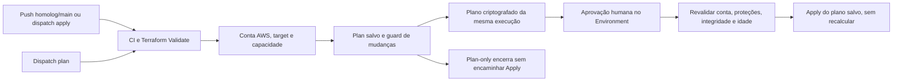

# CI/CD e checklist de entrega — Fase 3

Atualização: **29/10/2026**, com resultados consultados no GitHub Actions e AWS.
[README](../README.md) · [Homologação](EVIDENCIAS-HOMOLOG.md) · [Produção](EVIDENCIAS-PRODUCAO.md)

## Implementação e execução comprovada

| Ambiente | Branch | Plan / Apply Environment | Backend S3 |
| --- | --- | --- | --- |
| Homologação | homolog | homolog / homolog-apply | homolog/terraform.tfstate |
| Produção | main | production / production-apply | production/terraform.tfstate |

O bucket usado na demonstração é `fiap-tc3-k8s-tfstate-207975764067`. As chaves são
distintas. Compartilhar bucket e VPC não significa compartilhar state ou EC2.

O diagrama reúne dois modos: a saída para aprovação existe somente em push ou
dispatch apply; dispatch plan encerra antes dela. A aprovação humana impede
provisionamento autônomo irrestrito. **Início automático não equivale a Apply
totalmente automático sem aprovação.** O pipeline Terraform não faz join do
Worker nem deploy da aplicação.

## Execuções permanentes

| Run | Ambiente / commit | Resultado comprovado |
| --- | --- | --- |
| [40729596822](https://github.com/felipevrds/techChallengePosTech-k8s-infra/actions/runs/40729596822) | Homolog; 13c31cc9fcc072dbb1172b52523d99b351a14c21 | Push; CI, Plan e Apply success; 0 create/update/delete/replace, 6 unchanged |
| [40802453584](https://github.com/felipevrds/techChallengePosTech-k8s-infra/actions/runs/40802453584) | Homolog; f4b53cdd1dbf7d3ae943750416622fd5299f75bc | Dispatch Plan-only success; 0 create/update/delete/replace, 6 unchanged; Apply skipped |
| [40872446501](https://github.com/felipevrds/techChallengePosTech-k8s-infra/actions/runs/40872446501) | Feature; 877410e99abe5b508b8b93d82772736627a6d683 | CI aprovado para guard Plan-only e criptografia EBS; 19 testes locais já aprovados, sem repetição nesta coleta |
| [40873970406](https://github.com/felipevrds/techChallengePosTech-k8s-infra/actions/runs/40873970406) | Produção; f730def77cd47d27e41235d4dbf1b2be423ef4d4 | Dispatch Plan-only success; 6 create, 0 update/delete/replace; Apply skipped |
| [40876235431](https://github.com/felipevrds/techChallengePosTech-k8s-infra/actions/runs/40876235431) | Produção; f730def77cd47d27e41235d4dbf1b2be423ef4d4 | Dispatch apply; CI, Plan e Apply success; seis criações; proteção e artefato revalidados |

O último Apply foi confirmado em consultas AWS independentes: duas EC2 adicionais
running/checks ok, dois volumes raiz criptografados, SG próprio e state de produção
existente. Homologação continuou com dois nós Ready e workloads disponíveis.
As [evidências de produção](EVIDENCIAS-PRODUCAO.md) delimitam a validação de runtime.

## Proteções e operação

- [Terraform Deploy](../.github/workflows/terraform-deploy.yml): push em homolog/main,
  workflow_dispatch validate/plan/apply e CI reutilizável.
- [Terraform Validate](../.github/workflows/terraform-validate.yml): PRs homolog/main,
  pushes feature e chamadas reutilizáveis. Valida os dois diretórios sem backend,
  scripts, guards, workflows, manifests Kubernetes e configuração Helm.
- [Guard de aprovação](../scripts/require-apply-approval.mjs): branch exata, reviewer
  obrigatório, sem bypass administrativo e política exclusiva do Environment Apply.
- [Guard do plano](../scripts/terraform-plan-summary.mjs): bloqueia delete/replace,
  user_data in-place e alterações disruptivas de EC2, sem imprimir seus valores.
- [Artefato](../scripts/plan-artifact.mjs): AES-256-GCM, contexto da execução e validade
  máxima de quatro horas. Apply baixa o mesmo plano; não executa novo Plan.
- STS valida a conta antes do Plan e novamente após a aprovação. Credenciais
  temporárias AWS Academy devem permanecer válidas em cada Environment.
- `PRODUCTION_CAPACITY_APPROVED` é variável de **repositório**. Foi habilitada
  explicitamente no fork para o run de produção. Não consulta saldo ou quotas.
  Somente dispatch `action=plan` dispensa essa flag; push/apply não dispensam.

Qualquer novo push em main/homolog, inclusive documental, dispara o workflow.
Com capacidade habilitada, o fluxo pode chegar à aprovação; nenhum Apply deve
ser aprovado sem revisar o novo plano. Não reexecutar um run de Apply para fazer
somente leitura. A reprodução das consultas está nos documentos por ambiente.

No repositório oficial, configurar `INFRA_DEPLOY_REPOSITORY` explicitamente para
o destino permitido, credenciais próprias, backend, TFVARS e Environments protegidos.
O sucesso no fork não comprova execução no repositório oficial. Não reutilizar ou
importar recursos/state de outra conta sem procedimento específico. Consulte
[Reprodução em outra conta AWS e configuração do GitHub Actions](../GUIA-EXECUCAO.md#reprodução-em-outra-conta-aws-e-configuração-do-github-actions)
e a [especificação operacional](CICD-HOMOLOG.md).

## Checklist de requisitos FIAP

Base: [enunciado fornecido e rastreabilidade](REQUISITOS-FASE-3.md).
**Validado** identifica execução/consulta real ou confirmação manual explicitada.
**Implementado** indica código/documento existente, com limite indicado.
**Pendente** significa não comprovado neste conjunto; não afirma ausência no
trabalho das outras equipes.

| Requisito / recorte | Situação | Evidência e limite / próxima dependência |
| --- | --- | --- |
| Terraform e infraestrutura AWS de homologação | Validado | [Homologação](EVIDENCIAS-HOMOLOG.md): Plan/Apply e consultas EC2/S3 |
| Terraform e infraestrutura AWS de produção | Validado | [Produção](EVIDENCIAS-PRODUCAO.md): seis criações, Apply e confirmação AWS |
| State independente por ambiente | Validado | HeadObject das duas chaves; nenhum conteúdo de state publicado |
| Kubernetes kubeadm em EC2, aplicação em Kubernetes | Validado em homolog | Dois nós Ready, NestJS/PostgreSQL 1/1; [consulta atual](EVIDENCIAS-HOMOLOG.md#kubernetes--consulta-atual-por-ssh) |
| Kubernetes de produção operacional | Validado após bootstrap autorizado | Dois nós Ready, Calico 2/2 e Metrics Server com TLS; [resultado real](EVIDENCIAS-PRODUCAO.md#conclusão-do-bootstrap-e-hpa-de-produção) |
| Cluster com escalabilidade | Validado em homolog | [HPA sintético](../evidencias/2026-10-27-kubernetes-hpa.txt) 1→4→1; HPA escala Pods, não EC2 |
| Escalabilidade Kubernetes de produção | Validado com workload sintético | [HPA 1→2→1](../evidencias/2026-10-29-producao-kubernetes-hpa.txt), carga limitada e removida; contadores HTTP incluem timeouts, não é teste de NestJS |
| HPA da aplicação | Implementado; teste confirmado manualmente | [HPA API](../evidencias/HPA-APLICACAO.md): 1→2, 9.986 HTTP/zero erros; gerador no Pod, sem benchmark independente |
| CI/CD da infraestrutura homolog/produção | Validado no fork | Runs acima; início por push disponível, Apply protegido; produção demonstrada por dispatch |
| PR obrigatório e check de CI | Implementado e exercitado no fork | PRs e runs associados; guard de aprovação exercitado no Apply. Configuração do oficial depende do grupo |
| Quatro repositórios com deploy automático | Pendente no conjunto da entrega | Este documento comprova o pipeline de infraestrutura; pipelines de aplicação, Lambda e banco precisam de evidências próprias |
| Deploy automatizado NestJS | Pendente | Aplicação demonstrada em Kubernetes; Terraform não publica nem implanta a aplicação |
| Imagem Docker e instruções de execução | Implementado e demonstrado em homolog | [Registro da aplicação](../evidencias/tc3-deploy-resultado-local.json), digest e Swagger; manifests mantidos no fork da aplicação |
| Banco gerenciado | Pendente neste recorte | PostgreSQL emptyDir é temporário e **não atende** ao requisito de banco gerenciado; depende do repositório de banco |
| API Gateway e autenticação CPF/Lambda/JWT integrada | Pendente neste recorte | HTTP 401 e Swagger isolados não comprovam esse fluxo; depende das equipes responsáveis |
| CPU/memória Kubernetes e ferramenta de observabilidade | Validado historicamente em homolog | [Métricas Cloud](../evidencias/tc3-deploy-observabilidade-local.json); Metrics Server/top reconsultados em 29/10 |
| Logs e eventos no Grafana Cloud/Loki | Validado por confirmação manual | [Logs/eventos](../evidencias/2026-10-27-grafana-validacao-manual.md), [logs da API](../evidencias/tc3-deploy-loki-confirmacao-manual-local.json); sem captura de tela |
| Latência, uptime/healthchecks contínuos e alertas de ordens de serviço | Pendente integralmente | Readiness/Swagger não comprovam monitoramento contínuo, alertas de negócio ou latência instrumentada |
| Logs JSON correlacionados, traces e dashboards de negócio | Pendente | Não comprovados pelas métricas de recursos ou confirmação de logs; requer instrumentação e demonstração específicas |
| Componentes e decisões arquiteturais da infraestrutura | Implementado | [Arquitetura](ARQUITETURA-INFRA.md), [ADR observabilidade](ADR-001-observabilidade.md), [ADR CI/CD](ADR-002-CICD-AMBIENTES.md) |
| Sequência autenticação/OS, RFCs e justificativa/modelo ER do banco | Pendente no conjunto da entrega | Complementar com documentação das equipes; os ADRs de infraestrutura não substituem esses entregáveis |
| PDF único, vídeo até 15 minutos, links e usuário soat-architecture | Pendente de conferência final | Incluir os quatro repositórios, documentação e vídeo; acesso do avaliador não foi consultado nesta coleta |

## Critérios e limites do fechamento

Homologação: AWS preservada, dois nós Ready, workloads essenciais e métricas
disponíveis; evidências históricas de carga/Swagger/Cloud reaproveitadas sem
repetição. Produção: Terraform/EC2/EBS/SG/S3, identidade SSH, dois nós Ready,
Calico, Metrics Server TLS e HPA sintético 1→2→1 comprovados. O bootstrap é etapa
explícita [separada do Apply](BOOTSTRAP-PRODUCAO.md), não uma ação do workflow Terraform.
Não há alegação de alta disponibilidade com apenas um Control Plane e
um Worker, nem de ausência de perda em banco efêmero após reinícios.

O catálogo mantém saídas originais e confirmações manuais separadas. Nenhuma
imagem foi criada para simular evidência; não houve captura real nova, portanto
não foi criada pasta `docs/evidencias/`. Não publicar tokens, kubeconfig, TFVARS
reais, chaves, planos binários, logs privados ou conteúdo de Terraform State.
