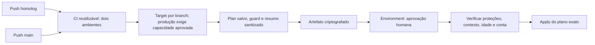

# CI/CD — homologação e produção

## Fluxo

| Target | Branch | Diretório | Environment Plan / Apply | State |
| --- | --- | --- | --- | --- |
| homolog | homolog | environments/homolog | homolog / homolog-apply | homolog/terraform.tfstate |
| production | main | environments/production | production / production-apply | production/terraform.tfstate |

scripts/deployment-target.mjs seleciona o target pela ref exata. Não aceita pasta
ou state arbitrários. Qualquer push nas branches alvo, inclusive documental,
corresponde ao gatilho. Falha no CI impede Plan/Apply.

## Solicitações

| Solicitação | Comportamento |
| --- | --- |
| Push homolog | CI, Plan e encaminhamento à aprovação |
| Push main | Equivalente, exigindo PRODUCTION_CAPACITY_APPROVED=true no repositório |
| Dispatch validate | CI sem AWS, mesmo com produção desabilitada |
| Dispatch plan | Somente Plan na branch alvo; produção dispensa a flag de capacidade |
| Dispatch apply | Confirmação APLICAR HOMOLOG ou APLICAR PRODUCTION e aprovação humana |

Sem confirmação de capacidade, push e dispatch apply de produção falham antes do
acesso AWS. O dispatch explícito plan permite revisão sem encaminhar Apply.
A verificação SSH opcional permanece somente em homolog/validate e depende de rede
previamente autorizada. O fluxo inicia automaticamente, mas não equivale a Apply
automático sem intervenção humana.

## Controles

- Allowlist de repositórios conhecidos; adaptação do destino exige configuração
  explícita. Não há wildcard para repositórios arbitrários.
- Required reviewers, sem bypass administrativo e política custom com somente
  homolog ou main conferidos antes de preparar artefato e após aprovação.
- Conta AWS confirmada por STS antes do Plan e após espera pela aprovação.
- Plano criptografado AES-256-GCM/scrypt com integridade e contexto de commit,
  run/tentativa, conta, região, repositório, ambiente, bucket e chave do state.
- Artefato retido por um dia; plano válido por quatro horas.
- Exclusões, substituições e ações desconhecidas bloqueadas.
- Atualizações EC2 user_data/user_data_base64 bloqueadas, inclusive valores
  desconhecidos/removidos.
- Mudanças disruptivas bloqueadas: ami, instance_type, subnet_id,
  availability_zone, key_name, root_block_device, vpc_security_group_ids e
  source_dest_check.
- Criação inicial e tags permitidas, sob aprovação.
- Ignore_changes de user_data nas duas EC2; bootstrap novo não é propagado
  automaticamente às instâncias existentes.
- Most_recent da AMI mantido; uma substituição proposta continua bloqueada.
- Apply não replaneja. Logs privados não são publicados; resumo mostra ações e
  nomes de campos, sem valores. Arquivos privados são removidos do runner.

Revisar também mudanças de rede permitidas pelo plano. O workflow não garante
ausência de qualquer impacto em SG e não executa join, Helm ou deploy NestJS.

## Configuração e reprodução

O [guia de execução](../GUIA-EXECUCAO.md#reprodução-em-outra-conta-aws-e-configuração-do-github-actions)
define Environments, secrets, variables, proteção de branches e seleção de conta.
Secrets Repository/Organization podem ser herdados quando a política permitir;
Environments não herdam secrets entre si. Plan/Apply devem resolver valores
coerentes. TFVARS é necessário somente no Plan, e a chave de criptografia deve
coincidir dentro de cada par.

State novo não adota as EC2 de outro ambiente. Sem capacidade para coexistência,
manter produção bloqueada e definir isolamento. Não existe destruição automática
para liberar quota.

## Validação e evidências

CI valida os dois diretórios Terraform sem backend, Bash por arquivo, PowerShell
AST, testes Node, actionlint, kubeconform e Helm.
ShellCheck não está habilitado. Os schemas nativos Kubernetes 1.34 são strict;
Alloy e sua CRD são skips explícitos. Não é teste real de admissão.

O registro de [CI/CD](../evidencias/CI-CD.md) distingue execuções documentadas,
testes locais, controles do código e confirmação manual.
Produção preparada não comprova infraestrutura de produção operacional.

[ADR](ADR-002-CICD-AMBIENTES.md) · [Evidências](../evidencias/INDEX.md)
