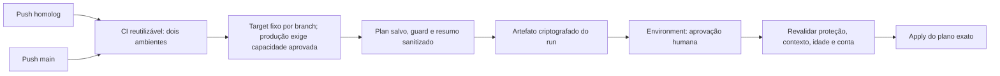

# CI/CD — homologação e produção

## Fluxo implementado

| Target | Branch | Diretório | Environment Plan / Apply | State |
| --- | --- | --- | --- | --- |
| homolog | homolog | environments/homolog | homolog / homolog-apply | homolog/terraform.tfstate |
| production | main | environments/production | production / production-apply | production/terraform.tfstate |

scripts/deployment-target.mjs seleciona o target pela ref exata. Não aceita pasta
ou state arbitrários. Qualquer push nessas branches corresponde ao gatilho,
inclusive documentação. Falha no CI impede Plan/Apply.

## Solicitações e aprovação

- Push homolog: Plan e encaminhamento à aprovação.
- Push main: equivalente, exigindo PRODUCTION_CAPACITY_APPROVED=true em variável
  de repositório; sem ela, request falha antes de AWS.
- Dispatch validate: CI sem AWS, inclusive antes de habilitar produção.
- Dispatch plan: somente Plan na branch alvo.
- Dispatch apply: APLICAR HOMOLOG ou APLICAR PRODUCTION, além da aprovação humana.
- SSH opcional permanece somente em homolog/validate e depende de rede autorizada.

O início é automático, mas Apply exige aprovação protegida. Não equivale a deploy
totalmente automático sem intervenção humana. Homolog mantém seu comportamento
protegido; produção foi implementada/testada localmente, sem execução remota.

## Barreiras

- Allowlist do fork e do original conhecido. Default: felipevrds. FernandoGreco
  requer INFRA_DEPLOY_REPOSITORY explícito.
- Required reviewers, sem bypass administrativo e política custom com apenas
  homolog ou main verificados antes do Plan para aprovação e depois da aprovação.
- STS confirma a conta antes do Plan e após espera; credenciais Academy expiram.
- AES-256-GCM/scrypt, integridade e contexto: commit, run, tentativa, conta, região,
  repositório, ambiente, bucket e chave do state. Não é possível usar plano de
  homolog em produção. Artefato retido por um dia; plano válido por quatro horas.
- Exclusões, substituições e ações desconhecidas são bloqueadas.
- Atualizações EC2 user_data/user_data_base64, inclusive valores desconhecidos/
  removidos, são bloqueadas.
- Atualizações disruptivas também são bloqueadas: ami, instance_type, subnet_id,
  availability_zone, key_name, root_block_device, vpc_security_group_ids,
  source_dest_check.
- Criação inicial e tags continuam permitidas, sob aprovação.
- As duas EC2 têm ignore_changes de user_data. Alterações futuras de bootstrap
  não se propagam automaticamente. Most_recent da AMI foi mantido; mudanças que
  proponham substituição continuam bloqueadas.
- Apply nunca gera novo plano. Logs privados não são publicados; o resumo mostra
  ações e nomes dos campos sem valores. Arquivos privados são removidos do runner.

Essas barreiras não cobrem qualquer impacto possível. Revisar também mudanças de
rede permitidas. Não há garantia de que um Apply nunca altere SG. O workflow não
chama deploy.sh, join, Helm ou deploy NestJS.

## Configuração externa e credenciais

A tabela completa está no
[guia de reprodução](../GUIA-EXECUCAO.md#reprodução-em-outra-conta-aws-e-configuração-do-github-actions).
Secrets Repository/Organization podem ser herdados quando permitido. Environments
não herdam secrets uns dos outros; Plan/Apply precisam resolver credenciais e
backend coerentes. TFVARS só é necessário no Plan.
A chave de criptografia deve coincidir no par; pode ser distinta entre ambientes.

Sem capacidade para outra infraestrutura, manter produção bloqueada e decidir
isolamento com o responsável pelo Lab. State novo não adota as EC2 de homolog.
Não existe destruição automática para liberar quota.

## CI e evidências

CI valida Terraform nos dois diretórios sem backend, todos os Bash por arquivo,
PowerShell AST, testes Node, actionlint, kubeconform e Helm. ShellCheck não está
habilitado. Native schemas Kubernetes 1.34 são strict; Alloy e CRD são skips
explícitos. Não é teste real de admissão.

- [Testes locais atuais](VALIDACAO-LOCAL-CICD.md).
- [CI real histórico](../evidencias/2026-10-27-ci-github-feature.md).
- [Índice de evidências](../evidencias/INDEX.md).
- [ADR de ambientes](ADR-002-CICD-AMBIENTES.md).

Produção preparada não equivale a infraestrutura/cluster de produção provisionado.
A evidência final informada de Apply em homolog possui origem identificada no índice.
